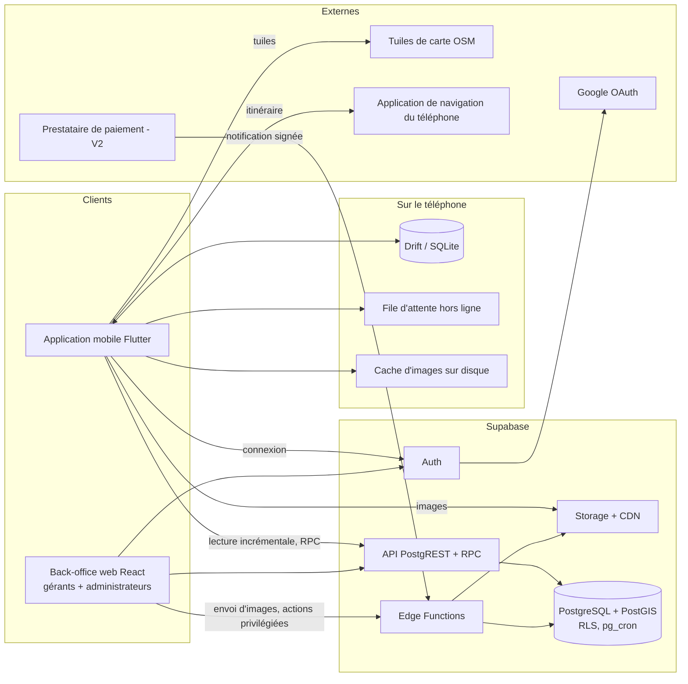

# Partie 4 — Architecture logicielle

## Vue d'ensemble



## Composants et responsabilités

| Composant | Responsabilité | Ne fait jamais |
| --- | --- | --- |
| Application mobile | Affichage, cache local, synchronisation, favoris, avis | Décider d'un droit, valider un paiement, détenir un secret |
| Drift | Source de vérité de l'affichage : l'interface lit **toujours** la base locale | — |
| Moteur de synchronisation | Tire les changements du serveur, pousse la file d'attente, gère reprises et temporisation | Bloquer la navigation |
| Back-office web | Gestion des fiches, publications, modération, abonnements | Contourner RLS (pas de clé `service_role`) |
| PostgREST + RPC | Lecture publique filtrée par RLS ; fonctions métier (`search_establishments`, `publish_event`, `sync_pull`) | — |
| Edge Functions | Traitement d'images, notifications de paiement, validation manuelle de paiement, envoi d'e-mails, actions avec `service_role` | Être appelées sans vérification du rôle de l'appelant |
| PostgreSQL | Données, contraintes, RLS, déclencheurs d'audit et de versionnage, tâches `pg_cron` | — |
| Storage | Images publiques (variantes), documents de vérification privés | Servir un document privé sans URL signée |

## Séparation des couches dans l'application mobile

Organisation par fonctionnalité, quatre couches par fonctionnalité :

```
presentation  → écrans, widgets, contrôleurs Riverpod (aucun accès réseau direct)
domain        → entités, règles pures (ex. « ouvert maintenant »), interfaces de dépôts
data          → dépôts : Drift (local) + Supabase (distant), correspondances DTO ↔ entités
core          → configuration, thème, réseau, synchronisation, erreurs, widgets communs
```

Règles : `presentation` ne connaît que `domain` ; `domain` ne dépend d'aucun paquet Flutter, Supabase ou Drift ;
les services externes (carte, navigation, partage) sont derrière des interfaces pour être remplacés et simulés en test.

## Structure du dépôt (monorepo)

```
kin-guide/
├── apps/
│   ├── mobile/                  # Application Flutter
│   │   ├── lib/
│   │   │   ├── app/             # démarrage, routeur, coquille de navigation
│   │   │   ├── core/            # config, theme, design_system, network, sync, database, errors
│   │   │   ├── features/        # home, explore, map, whats_new, deals, establishment,
│   │   │   │                    # favorites, auth, profile, settings
│   │   │   └── l10n/            # fichiers ARB (français)
│   │   ├── test/
│   │   ├── android/  ios/
│   │   └── env/                 # dev.example.json, prod.example.json (jamais de vraies clés)
│   └── backoffice/              # Application web React + TypeScript (à partir de la Mission 07)
├── supabase/
│   ├── migrations/              # SQL versionné
│   ├── functions/               # Edge Functions
│   ├── tests/                   # tests SQL (RLS, contraintes, fonctions)
│   └── seed.sql                 # données de référence de développement
├── tools/                       # import de données, scripts de vérification
├── docs/
├── DESIGN.md                    # système de design (Mission 01)
└── .github/workflows/
```

> Cette structure suppose un dépôt réservé à Kin Guide. Dans le dépôt actuel, la racine est occupée par le projet
> Rider Group (`lib/`, `android/`, `ios/`, `supabase/`, `pubspec.yaml`, `.github/workflows/ci.yml`) : voir la
> décision D-01.

## Environnements et configuration

| Environnement | Projet Supabase | Saveur Flutter | Usage |
| --- | --- | --- | --- |
| local | `supabase start` (Docker) | dev | Développement et tests SQL |
| dev | Projet de développement | dev | Tests sur téléphone ; seul projet relié au MCP |
| prod | Projet de production | prod | Public ; migrations appliquées par CI ou manuellement, jamais par MCP |

Configuration mobile par `--dart-define-from-file=env/<saveur>.json` : URL du projet et clé publique uniquement.
Identifiants d'application distincts par saveur (suffixe `.dev`) pour installer les deux versions côte à côte.

## Échanges de données principaux

| Flux | Chemin | Remarque |
| --- | --- | --- |
| Lecture du catalogue | Mobile → `sync_pull` → Drift → interface | Par lots, incrémental, voir Partie 6 |
| Recherche | Hors ligne : SQL local. En ligne : RPC `search_establishments` pour la proximité et la tolérance aux fautes | Même forme de résultat |
| Favori, lieu visité, avis | Interface → Drift + file d'attente → API quand le serveur répond | Idempotent (identifiant généré sur le téléphone) |
| Statistiques | Mobile → lot d'événements → RPC `track_interactions` | Envoyé par lots, jamais bloquant |
| Publication par un gérant | Back-office → RPC `publish_*` | Droits de forfait vérifiés dans la fonction |
| Envoi d'image | Back-office → compression locale → Edge Function → variantes → Storage | Validation du type réel et de la taille côté serveur |
| Paiement (V2) | Prestataire → Edge Function `payment-webhook` → base | Signature vérifiée, traitement idempotent |

## Évolutivité prévue

- **Nouvelles catégories** : table `categories` hiérarchique, aucune valeur codée en dur.
- **Autres villes** : `cities` en tête de la hiérarchie géographique ; la synchronisation est filtrée par ville.
- **Billetterie** : `events` a déjà prix et devise ; des tables `ticket_types` et `orders` s'ajouteront sans toucher
  aux événements, et réutiliseront `payments`.
- **Mises à jour progressives** : chaque réponse de synchronisation porte une version de schéma minimale ; une
  application trop ancienne affiche un message de mise à jour au lieu d'échouer.
