# Partie 5 — Architecture de base de données

> Schéma cible, à créer progressivement par migrations (les tables nécessaires à chaque mission sont indiquées dans
> la [feuille de route](10-mvp-feuille-de-route.md)). Noms en anglais, `snake_case`, tables au pluriel.

## Conventions communes

| Élément | Règle |
| --- | --- |
| Clé primaire | `id uuid default gen_random_uuid()`, sauf tables de référence à code (`currencies.code`) |
| Horodatage | `created_at`, `updated_at` en `timestamptz` ; `updated_at` mis à jour par déclencheur |
| Suppression | Tables synchronisées : `deleted_at timestamptz` (suppression logique), jamais de `DELETE` côté application |
| Synchronisation | Tables synchronisées : `updated_at` indexé avec `id` ; voir Partie 6 |
| Argent | `*_amount bigint` en unité mineure + `*_currency char(3)` référencant `currencies` ; jamais de `float` |
| Statuts | Types `enum` PostgreSQL ou `text` + contrainte `check` ; transitions contrôlées par fonctions |
| Heure locale | Horaires d'ouverture en `time` (heure de Kinshasa) ; instants en `timestamptz` |
| Géographie | `geography(Point, 4326)` + index GiST |
| RLS | Activé sur **toutes** les tables, sans exception ; aucune politique = aucun accès |
| Auteur | `created_by`, `updated_by` référencent `profiles(id)` sur les contenus gérés |

Fonctions d'aide utilisées dans les politiques : `is_admin()`, `is_moderator()`,
`is_establishment_member(establishment_id, min_role)`, `has_entitlement(establishment_id, key)`. Elles sont
`security definer`, avec `search_path` fixé, et lisent les rôles en base (jamais dans un champ modifiable par
l'utilisateur).

Légende des accès : **Public** = lecture anonyme des lignes publiées ; **Soi** = l'utilisateur sur ses propres
lignes ; **Membre** = collaborateur de l'établissement ; **Admin** = administrateur ; **Serveur** = fonctions
`security definer` ou Edge Functions uniquement.

## 1. Identités et permissions

| Table | Rôle | Champs principaux | Clés et contraintes | Index | Accès |
| --- | --- | --- | --- | --- | --- |
| `profiles` | Profil d'un compte (1-1 avec `auth.users`) | `id uuid`, `display_name text`, `avatar_path text`, `locale text`, `marketing_consent bool`, `status` (`active`,`suspended`,`deleted`) | PK `id` = FK `auth.users(id)` ; `display_name` 2–50 caractères | `status` | Lecture publique limitée à une vue (`display_name`, avatar) ; Soi en modification, sauf `status` ; Admin |
| `platform_roles` | Rôles de plateforme | `user_id`, `role` (`admin`,`moderator`), `granted_by`, `granted_at` | PK (`user_id`,`role`) ; FK `profiles` | — | Lecture Soi ; écriture Serveur uniquement |
| `business_accounts` | Entité cliente (facturation) | `id`, `legal_name`, `contact_email`, `contact_phone`, `tax_id`, `owner_id`, `status` | FK `owner_id → profiles` | `owner_id` | Soi (propriétaire) ; Admin |
| `establishment_members` | Lien utilisateur ↔ établissement | `establishment_id`, `user_id`, `role` (`owner`,`manager`,`editor`), `invited_by`, `status` | PK (`establishment_id`,`user_id`) ; un seul `owner` actif par établissement (index unique partiel) | `user_id` | Membre en lecture ; `owner` gère les collaborateurs ; création du premier `owner` par Serveur (après revendication validée) |

## 2. Géographie et référentiels

| Table | Rôle | Champs principaux | Clés et contraintes | Index | Accès |
| --- | --- | --- | --- | --- | --- |
| `cities` | Villes couvertes | `id`, `name`, `slug`, `timezone` (défaut `Africa/Kinshasa`), `center geography`, `is_active` | `slug` unique | — | Public ; Admin |
| `communes` | Communes (24 à Kinshasa) | `id`, `city_id`, `name`, `slug` | FK `cities` ; unique (`city_id`,`slug`) | `city_id` | Public ; Admin |
| `neighborhoods` | Quartiers | `id`, `commune_id`, `name`, `slug` | FK `communes` ; unique (`commune_id`,`slug`) | `commune_id` | Public ; Admin |
| `categories` | Catégories extensibles | `id`, `parent_id`, `slug`, `name`, `icon`, `sort_order`, `is_active` | `slug` unique ; FK `parent_id → categories` | `parent_id` | Public ; Admin |

## 3. Établissements

| Table | Rôle | Champs principaux | Clés et contraintes | Index | Accès |
| --- | --- | --- | --- | --- | --- |
| `establishments` | Fiche d'un lieu | `id`, `city_id`, `commune_id`, `neighborhood_id`, `category_id`, `business_account_id` (nul si non revendiquée), `name`, `slug`, `alt_names text[]`, `description`, `address_text`, `location geography`, `location_accuracy` (`exact`,`approximate`,`neighborhood`), `price_level smallint`, `status` (`draft`,`published`,`hidden`,`closed_permanently`), `verification_status` (`unverified`,`pending`,`verified`,`rejected`), `is_claimed bool`, `rating_avg numeric(2,1)`, `rating_count int`, `source text`, `last_confirmed_at` | FK vers géographie, catégorie, compte ; unique (`city_id`,`slug`) ; `rating_avg` entre 1 et 5 ; `location` obligatoire pour publier | GiST `location` ; GIN trigrammes sur `name` sans accents ; (`city_id`,`status`,`category_id`) ; (`updated_at`,`id`) | Public si `published` ; Membre en modification des champs éditoriaux ; `status`, `verification_status`, notes : Serveur/Admin |
| `opening_hours` | Horaires habituels | `id`, `establishment_id`, `day_of_week smallint` (1 = lundi), `opens_at time`, `closes_at time` | FK ; `closes_at <= opens_at` signifie « ferme le lendemain » ; pas de chevauchement sur un même jour (contrainte d'exclusion) | (`establishment_id`,`day_of_week`) | Public ; Membre |
| `opening_hour_exceptions` | Fermetures et horaires exceptionnels | `id`, `establishment_id`, `date date`, `is_closed bool`, `opens_at`, `closes_at`, `note` | FK ; unique (`establishment_id`,`date`,`opens_at`) ; si `is_closed`, heures nulles | (`establishment_id`,`date`) | Public ; Membre |
| `establishment_contacts` | Moyens de contact | `id`, `establishment_id`, `kind` (`phone`,`whatsapp`,`email`,`website`,`facebook`,`instagram`,`tiktok`,`x`), `value`, `label`, `sort_order` | FK ; unique (`establishment_id`,`kind`,`value`) ; téléphones au format E.164 | `establishment_id` | Public ; Membre |
| `media_assets` | Image stockée et ses variantes | `id`, `owner_establishment_id`, `storage_path`, `width`, `height`, `blurhash`, `variants jsonb`, `byte_size`, `mime_type`, `checksum`, `status` (`processing`,`ready`,`rejected`), `uploaded_by` | FK ; `checksum` unique par établissement (anti-doublon) | `owner_establishment_id` | Public si `ready` et rattaché à un contenu publié ; création par Edge Function |
| `establishment_photos` | Galerie d'une fiche | `establishment_id`, `media_id`, `sort_order`, `is_cover` | PK (`establishment_id`,`media_id`) ; une seule couverture (index unique partiel) | — | Public ; Membre |
| `menus` | Carte ou grille tarifaire | `id`, `establishment_id`, `title`, `sort_order`, `is_active` | FK | `establishment_id` | Public ; Membre |
| `menu_items` | Ligne de menu ou tarif | `id`, `menu_id`, `name`, `description`, `price_amount bigint`, `price_currency`, `is_available`, `sort_order` | FK ; `price_amount >= 0` | `menu_id` | Public ; Membre |
| `establishment_claims` | Demande de revendication | `id`, `establishment_id`, `claimant_id`, `business_account_id`, `status` (`submitted`,`under_review`,`approved`,`rejected`,`withdrawn`), `evidence_note`, `reviewed_by`, `reviewed_at`, `decision_reason` | FK ; une seule demande ouverte par (`establishment_id`,`claimant_id`) | `status` | Soi (demandeur) ; Admin ; approbation par Serveur |
| `claim_documents` | Pièces justificatives | `id`, `claim_id`, `storage_path` (compartiment privé), `kind` | FK | `claim_id` | Soi en dépôt ; Admin en lecture par URL signée |
| `location_corrections` | Proposition de correction GPS | `id`, `establishment_id`, `proposed_location`, `proposed_by`, `status`, `reviewed_by` | FK | `status` | Soi ; Membre ; Admin |

## 4. Activités publiques

| Table | Rôle | Champs principaux | Clés et contraintes | Index | Accès |
| --- | --- | --- | --- | --- | --- |
| `events` | Événement | `id`, `establishment_id`, `category_id`, `title`, `description`, `cover_media_id`, `starts_at`, `ends_at`, `price_amount`, `price_currency`, `is_free bool`, `conditions`, `booking_info`, `contact_phone`, `status` (`draft`,`pending_review`,`published`,`suspended`,`cancelled`,`rejected`), `publish_at`, `published_at` | FK ; `ends_at > starts_at` ; prix et devise ensemble ou absents | (`status`,`ends_at`) ; (`establishment_id`,`starts_at`) ; (`updated_at`,`id`) | Public si `published` et `publish_at <= now()` ; Membre en brouillon ; publication par RPC `publish_event` |
| `promotions` | Promotion | `id`, `establishment_id`, `kind` (`happy_hour`,`menu`,`discount`,`weekend`,`limited`), `title`, `description`, `terms`, `starts_at`, `expires_at`, `old_price_amount`, `new_price_amount`, `price_currency`, `status` (`draft`,`pending_review`,`active`,`suspended`,`rejected`) | FK ; `expires_at > starts_at` ; `new_price_amount < old_price_amount` si les deux existent | (`status`,`expires_at`) ; (`establishment_id`) ; (`updated_at`,`id`) | Public si `active` et dans la période ; publication par RPC `publish_promotion` |
| `content_media` | Images d'un événement ou d'une promotion | `content_type` (`event`,`promotion`), `content_id`, `media_id`, `sort_order` | PK (`content_type`,`content_id`,`media_id`) | — | Suit le contenu |
| `reports` | Signalement | `id`, `target_type` (`establishment`,`event`,`promotion`,`review`,`photo`), `target_id`, `reporter_id`, `reason`, `details`, `status` (`open`,`in_review`,`resolved`,`dismissed`) | Un signalement ouvert par (`reporter_id`,`target_type`,`target_id`) | (`status`,`created_at`) | Soi en création ; Modérateur/Admin |
| `moderation_actions` | Décision de modération | `id`, `target_type`, `target_id`, `action` (`approve`,`reject`,`hide`,`restore`,`suspend`), `reason`, `moderator_id`, `report_id` | FK | (`target_type`,`target_id`) | Modérateur/Admin ; insertion seule |
| `editorial_picks` | « Coups de cœur » éditoriaux | `id`, `target_type`, `target_id`, `title`, `starts_at`, `ends_at`, `sort_order` | Aucun lien avec un paiement | (`starts_at`,`ends_at`) | Public ; Admin |

**Expiration sans tâche planifiée.** « À venir » et « active » sont calculés à la lecture
(`ends_at > now()`, `expires_at > now()`), dans des vues et dans les requêtes locales : un événement terminé ou une
promotion expirée disparaît des listes même si aucun traitement n'a tourné et même hors ligne. Le statut « expiré »
demandé par le cahier des charges est donc **dérivé**, pas stocké.

## 5. Engagement

| Table | Rôle | Champs principaux | Clés et contraintes | Index | Accès |
| --- | --- | --- | --- | --- | --- |
| `favorites` | Favoris | `user_id`, `establishment_id`, `created_at` | PK (`user_id`,`establishment_id`) | `user_id` | Soi |
| `visited_places` | Lieux marqués comme visités (déclaratif) | `user_id`, `establishment_id`, `visited_on date`, `note` | PK (`user_id`,`establishment_id`,`visited_on`) | `user_id` | Soi ; aucune coordonnée enregistrée |
| `reviews` | Note et avis | `id`, `establishment_id`, `author_id`, `rating smallint`, `body`, `status` (`published`,`hidden`,`removed`), `visit_proof_id`, `edited_at` | Unique (`establishment_id`,`author_id`) : un avis par personne et par lieu ; `rating` entre 1 et 5 ; `body` ≤ 1 000 caractères | (`establishment_id`,`status`,`created_at`) | Public si `published` ; Soi ; un membre de l'établissement ne peut pas noter son propre lieu |
| `visit_proofs` | Preuve de visite (V2) | `id`, `user_id`, `establishment_id`, `method` (`venue_code`,`qr`), `verified_at` | FK | (`user_id`,`establishment_id`) | Création par Serveur uniquement |
| `interaction_events` | Événements statistiques bruts | `id bigint`, `occurred_at`, `establishment_id`, `target_type`, `target_id`, `kind` (`view`,`event_click`,`promo_click`,`directions`,`contact_click`), `device_hash`, `campaign_id` | Partitionnée par mois ; purge à 90 jours | (`establishment_id`,`occurred_at`) | Insertion par RPC ; aucune lecture directe |
| `interaction_daily_stats` | Agrégats journaliers | `day`, `establishment_id`, `target_type`, `target_id`, `kind`, `count`, `unique_devices` | PK sur ces colonnes | — | Membre avec droit `stats` ; Admin |

`rating_avg` et `rating_count` de `establishments` sont recalculés par déclencheur sur `reviews` (seuls les avis
`published` comptent). Un avis n'est affiché « visite vérifiée » que si `visit_proof_id` est renseigné.

## 6. Monétisation

| Table | Rôle | Champs principaux | Clés et contraintes | Index | Accès |
| --- | --- | --- | --- | --- | --- |
| `plans` | Forfaits | `id`, `code` (`free`,`pro`,`premium`), `name`, `is_active`, `sort_order` | `code` unique | — | Public ; Admin |
| `plan_prices` | Prix par période et devise | `id`, `plan_id`, `billing_period` (`monthly`,`yearly`), `amount`, `currency`, `valid_from`, `valid_to` | FK ; pas de chevauchement de validité pour un même triplet | `plan_id` | Public ; Admin |
| `plan_entitlements` | Droits d'un forfait | `plan_id`, `key` (ex. `events.publish`, `promotions.max_active`, `stats.view`, `photos.max`), `value jsonb` | PK (`plan_id`,`key`) | — | Public ; Admin |
| `subscriptions` | Abonnement d'un établissement | `id`, `establishment_id`, `business_account_id`, `plan_id`, `billing_period`, `status` (`trialing`,`active`,`pending_payment`,`past_due`,`expired`,`cancelled`,`suspended`), `trial_ends_at`, `current_period_start`, `current_period_end`, `cancel_at_period_end`, `cancelled_at` | FK ; un seul abonnement « en cours » par établissement (index unique partiel) | (`status`,`current_period_end`) | Membre en lecture ; modification par Serveur uniquement |
| `invoices` | Facture | `id`, `number`, `business_account_id`, `status` (`draft`,`issued`,`paid`,`void`), `total_amount`, `currency`, `issued_at`, `due_at`, `paid_at`, `pdf_path` | `number` unique, séquentiel sans trou ; immuable une fois émise | `business_account_id` | Propriétaire du compte en lecture ; Serveur |
| `invoice_lines` | Ligne de facture | `id`, `invoice_id`, `description`, `quantity`, `unit_amount`, `subscription_id`, `campaign_id` | FK | `invoice_id` | Suit la facture |
| `payments` | Tentative de règlement d'une facture | `id`, `invoice_id`, `method` (`manual_mobile_money`,`manual_cash`,`provider_mobile_money`,`provider_card`), `provider`, `amount`, `currency`, `status` (`initiated`,`pending`,`succeeded`,`failed`,`refunded`), `idempotency_key`, `payer_reference`, `validated_by`, `validated_at` | `idempotency_key` unique ; montant et devise égaux à ceux de la facture | `invoice_id` ; `status` | Propriétaire du compte en lecture ; Serveur |
| `payment_transactions` | Notification reçue du prestataire ou saisie manuelle | `id`, `payment_id`, `provider`, `provider_transaction_id`, `event_type`, `raw_payload jsonb`, `signature_valid bool`, `received_at`, `processed_at` | **Unique (`provider`,`provider_transaction_id`,`event_type`)** : rejoue sans effet | `payment_id` | Serveur ; Admin en lecture |
| `ad_placements` | Emplacements publicitaires | `id`, `code` (`featured`,`home_carousel`,`sponsored_result`,`banner`), `name`, `max_concurrent`, `is_active` | `code` unique | — | Public ; Admin |
| `ad_rates` | Tarifs des emplacements | `id`, `placement_id`, `unit` (`day`,`week`), `amount`, `currency`, `valid_from`, `valid_to` | FK | `placement_id` | Public ; Admin |
| `campaigns` | Campagne sponsorisée | `id`, `establishment_id`, `placement_id`, `target_type` (`establishment`,`event`,`promotion`), `target_id`, `starts_at`, `ends_at`, `price_amount`, `currency`, `invoice_id`, `status` (`draft`,`pending_payment`,`pending_review`,`scheduled`,`running`,`paused`,`completed`,`rejected`,`cancelled`) | FK ; `ends_at > starts_at` ; ne passe à `scheduled` que si la facture est `paid` | (`placement_id`,`status`,`starts_at`,`ends_at`) | Public pour les campagnes en cours ; Membre ; Serveur pour les statuts |
| `campaign_daily_stats` | Statistiques de campagne | `day`, `campaign_id`, `impressions`, `clicks` | PK (`day`,`campaign_id`) | — | Membre ; Admin |

## 7. Gestion technique

| Table | Rôle | Champs principaux | Clés et contraintes | Index | Accès |
| --- | --- | --- | --- | --- | --- |
| `currencies` | Devises | `code char(3)` (`USD`,`CDF`), `name`, `minor_unit smallint`, `symbol` | PK `code` | — | Public ; Admin |
| `exchange_rates` | Taux historisés | `id`, `base_currency`, `quote_currency`, `rate numeric(20,8)`, `valid_from`, `source`, `created_by` | FK ; `rate > 0` ; unique (`base_currency`,`quote_currency`,`valid_from`) ; insertion seule | (`base_currency`,`quote_currency`,`valid_from desc`) | Public ; Admin |
| `app_settings` | Paramètres de la plateforme | `key`, `value jsonb`, `is_public`, `updated_by` | PK `key` | — | Public si `is_public` ; Admin |
| `audit_logs` | Journal d'audit | `id bigint`, `occurred_at`, `actor_id`, `actor_role`, `action`, `target_table`, `target_id`, `before jsonb`, `after jsonb`, `ip inet` | Insertion seule ; aucune politique de modification ni de suppression | (`target_table`,`target_id`) ; `occurred_at` | Admin en lecture ; écriture par déclencheurs |
| `rate_limits` | Compteurs anti-abus | `subject`, `action`, `window_start`, `count` | PK (`subject`,`action`,`window_start`) | — | Serveur |

## Diagramme entité-relation

```mermaid
erDiagram
  profiles ||--o{ platform_roles : "a"
  profiles ||--o{ business_accounts : "possède"
  profiles ||--o{ establishment_members : "est"
  profiles ||--o{ favorites : "enregistre"
  profiles ||--o{ visited_places : "déclare"
  profiles ||--o{ reviews : "écrit"
  profiles ||--o{ reports : "signale"

  cities ||--o{ communes : "contient"
  communes ||--o{ neighborhoods : "contient"
  cities ||--o{ establishments : "situe"
  communes ||--o{ establishments : "situe"
  neighborhoods |o--o{ establishments : "situe"
  categories ||--o{ establishments : "classe"
  categories |o--o{ categories : "parent"

  business_accounts |o--o{ establishments : "gère"
  establishments ||--o{ establishment_members : "a"
  establishments ||--o{ opening_hours : "a"
  establishments ||--o{ opening_hour_exceptions : "a"
  establishments ||--o{ establishment_contacts : "a"
  establishments ||--o{ establishment_photos : "a"
  media_assets ||--o{ establishment_photos : "illustre"
  establishments ||--o{ menus : "propose"
  menus ||--o{ menu_items : "contient"
  establishments ||--o{ establishment_claims : "reçoit"
  establishment_claims ||--o{ claim_documents : "joint"

  establishments ||--o{ events : "organise"
  establishments ||--o{ promotions : "propose"
  events ||--o{ content_media : "illustre"
  promotions ||--o{ content_media : "illustre"
  media_assets ||--o{ content_media : "sert"
  reports ||--o{ moderation_actions : "entraîne"

  establishments ||--o{ favorites : "reçoit"
  establishments ||--o{ reviews : "reçoit"
  visit_proofs |o--o| reviews : "justifie"
  establishments ||--o{ interaction_daily_stats : "mesure"

  plans ||--o{ plan_prices : "tarifé"
  plans ||--o{ plan_entitlements : "accorde"
  plans ||--o{ subscriptions : "choisi"
  establishments ||--o{ subscriptions : "souscrit"
  business_accounts ||--o{ invoices : "reçoit"
  invoices ||--o{ invoice_lines : "détaille"
  invoices ||--o{ payments : "réglée par"
  payments ||--o{ payment_transactions : "trace"
  ad_placements ||--o{ ad_rates : "tarifé"
  ad_placements ||--o{ campaigns : "accueille"
  establishments ||--o{ campaigns : "achète"
  invoices |o--o{ campaigns : "facture"
  campaigns ||--o{ campaign_daily_stats : "mesure"

  currencies ||--o{ exchange_rates : "base"
  currencies ||--o{ plan_prices : "devise"
```

## Éviter les doublons

| Cas | Mécanisme |
| --- | --- |
| Même établissement saisi deux fois | Recherche de similarité à la création (nom sans accents proche **et** distance inférieure à 100 m) : avertissement au gérant, blocage levé par un administrateur ; fusion administrative possible |
| Double favori, double avis | Clés primaires et contraintes d'unicité composées |
| Double envoi depuis la file hors ligne | Identifiant généré sur le téléphone + `on conflict do nothing` |
| Paiement notifié deux fois | Unicité (`provider`,`provider_transaction_id`,`event_type`) + `idempotency_key` |
| Même image envoyée deux fois | `checksum` unique par établissement |
| Deux abonnements actifs | Index unique partiel sur `subscriptions(establishment_id)` pour les statuts en cours |

## Intégrité

- Clés étrangères partout, `on delete restrict` par défaut ; `cascade` uniquement pour les tables enfants pures
  (horaires, contacts, lignes de menu).
- Transitions de statut dans des fonctions (`publish_event`, `approve_claim`, `mark_payment_succeeded`) ; les
  colonnes de statut ne sont pas modifiables directement par les clients (droits de colonne + RLS).
- Colonnes dénormalisées (`rating_avg`, `rating_count`) maintenues par déclencheur et vérifiées par un test SQL.
- Tout changement sensible (rôle, vérification, abonnement, paiement, modération) écrit dans `audit_logs`.

## Champs de dates, d'expiration et de modification

| Besoin | Champs |
| --- | --- |
| Synchronisation | `updated_at`, `deleted_at` sur toutes les tables synchronisées |
| Fraîcheur d'une fiche | `last_confirmed_at` |
| Événements | `starts_at`, `ends_at`, `publish_at`, `published_at` |
| Promotions | `starts_at`, `expires_at` |
| Abonnements | `trial_ends_at`, `current_period_start`, `current_period_end`, `cancelled_at` |
| Campagnes | `starts_at`, `ends_at` |
| Prix et taux | `valid_from`, `valid_to` |
| Décisions | `reviewed_at`, `validated_at`, `occurred_at` |
