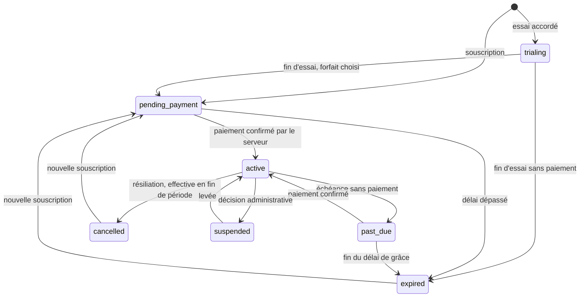

# Partie 8 — Modèle de monétisation

> Les prix des forfaits et des emplacements ne sont pas fixés ici : ce sont des données (`plan_prices`, `ad_rates`)
> que vous définirez. Aucun prix n'est codé dans l'application.

## Forfaits et droits

Les droits ne sont pas attachés au nom du forfait mais à des **clés de droit** (`plan_entitlements`). Proposition de
départ, à ajuster :

| Clé de droit | Gratuit | Pro | Premium |
| --- | --- | --- | --- |
| `listing.basic` (fiche, contacts, localisation) | Oui | Oui | Oui |
| `photos.max` | 5 | 20 | 50 |
| `events.max_active` | 0 | 5 | Illimité (plafond technique : 30) |
| `promotions.max_active` | 0 | 5 | Illimité (plafond technique : 30) |
| `stats.view` | Non | Oui | Oui |
| `stats.history_days` | — | 30 | 365 |
| `members.max` (collaborateurs) | 1 | 3 | 10 |
| `campaigns.purchase` | Oui | Oui | Oui |

« Illimité » est une promesse commerciale ; un plafond technique anti-abus s'applique toujours.

La fonction `has_entitlement(establishment_id, key)` lit l'abonnement en cours et le forfait associé. Elle est
appelée par les fonctions de publication et par les politiques RLS : c'est le **seul** endroit où un droit payant
est décidé.

## Cycle de vie d'un abonnement

| Statut | Droits payants | Remarque |
| --- | --- | --- |
| `trialing` | Oui, jusqu'à `trial_ends_at` | Un seul essai par établissement |
| `active` | Oui, jusqu'à `current_period_end` | |
| `pending_payment` | Non | Première souscription non réglée |
| `past_due` | Oui pendant le délai de grâce (proposé : 7 jours) | Rappel au gérant |
| `expired`, `cancelled` | Non (retour au Gratuit) | `cancelled` garde ses droits jusqu'à la fin de la période payée |
| `suspended` | Non | Motif consigné dans l'audit |

Mensuel et annuel : `billing_period` sur l'abonnement, prix dans `plan_prices`.

### Perte des droits sans perte de données

Les droits sont **calculés à la lecture** à partir des dates : dès que `current_period_end` (plus le délai de grâce)
est passé, `has_entitlement` répond non, même si aucune tâche planifiée n'a tourné. Une tâche `pg_cron` quotidienne
met ensuite les statuts à jour et notifie le gérant.

À l'expiration, rien n'est supprimé. Les événements et promotions au-delà de ce que permet le forfait Gratuit
passent en `suspended` avec le motif « abonnement expiré » ; les photos excédentaires sont masquées, pas effacées.
Tout redevient publiable après renouvellement.

## Paiements

### MVP : validation manuelle (phase pilote)

1. Le gérant choisit un forfait : une facture `issued` et un paiement `pending` sont créés, avec une **référence**
   unique à indiquer dans son transfert Mobile Money ou à remettre en espèces.
2. Il déclare son paiement (numéro de transaction de l'opérateur, capture facultative).
3. Un administrateur rapproche le paiement de ses relevés et valide ou refuse dans le back-office.
4. La fonction `mark_payment_succeeded` — exécutable par un administrateur uniquement — passe le paiement à
   `succeeded`, la facture à `paid`, active l'abonnement, écrit l'audit. Le tout dans une seule transaction.

Le numéro de transaction saisi est unique : le même reçu ne peut pas servir deux fois.

### V2 : prestataire de paiement

Interface commune `PaymentProvider` côté Edge Functions : `createPayment`, `verifyWebhook`, `getStatus`. Déroulé :

1. Le back-office demande un paiement à l'Edge Function `create-payment` (clé d'idempotence fournie).
2. Le prestataire sollicite le client (validation sur son téléphone pour le Mobile Money).
3. Le prestataire notifie l'Edge Function `payment-webhook`. Celle-ci vérifie la signature, enregistre la
   notification dans `payment_transactions` (contrainte d'unicité : une notification rejouée est ignorée),
   **reconfirme** le statut auprès du prestataire, compare montant et devise à la facture, puis applique.
4. L'écran du gérant ne fait qu'**interroger** le statut. Le message « paiement réussi » affiché par un client ne
   déclenche jamais rien.

| Cas | Comportement |
| --- | --- |
| Notification reçue deux fois | Seconde insertion rejetée par l'unicité ; aucun effet |
| Paiement refusé | Paiement `failed`, facture toujours `issued`, abonnement inchangé, nouvel essai possible |
| Montant ou devise différents de la facture | Paiement mis en anomalie, revue manuelle, aucun déblocage |
| Notification jamais reçue | Tâche de rapprochement qui interroge le prestataire pour les paiements `pending` anciens |

### Prestataires en RDC : état de la vérification

Recherche web du 2026-11-12, **sans confirmation contractuelle** :

| Prestataire | Ce que les sources indiquent | À vérifier avant tout choix |
| --- | --- | --- |
| FlexPay | Passerelle congolaise ; M-Pesa, Airtel Money, Orange Money, Afrimoney ; cartes selon une fiche d'annuaire | Documentation officielle, contrat, frais, devises USD/CDF, délais de reversement, notifications signées |
| MaxiCash | Cité comme agrégateur local actif en RDC | Idem ; aucune documentation technique trouvée |
| Onafriq | Agrégateur panafricain ; partenariat Visa Pay en RDC | Accès pour une petite structure, conditions d'entrée |
| Intégration directe M-Pesa (Vodacom Open API) | Possible opérateur par opérateur | Un contrat par opérateur : lourd pour un lancement |
| CinetPay et autres | Aucune information trouvée sur la RDC | Couverture réelle |

Recommandation : ne choisir qu'après avoir obtenu, par écrit, les conditions de deux agrégateurs et réussi un
paiement de test dans chaque devise. Sources : fiche FlexPay (<https://paymentproviders.io/providers/flexpay-africa.md>),
documentation M-Pesa RDC d'un intégrateur (<https://docs.centipidbilling.com/billing/payment-gateways/vodacom-mpesa>),
annonce Onafriq/Visa (<https://onafriq.com/article/inclusion-financiere-acceleree-visa-et-onafriq-lancent-visa-pay-en-rdc>),
appel d'offres citant MaxiCash (<https://www.codeur.com/projects/485145-connexion-api-mobile-money-rdc-m-pesa-orange-airtel-sur-appli-pos>).

### Factures

Numéro séquentiel sans trou attribué à l'émission, lignes figées, PDF généré côté serveur (skill `pdf`) et stocké
dans le compartiment privé. Une facture émise n'est jamais modifiée : une erreur se corrige par annulation et
nouvelle facture. Mentions obligatoires et fiscalité : **à valider avec un comptable**.

## Devises

- Chaque prix garde sa devise d'origine (`*_amount` en unité mineure + `*_currency`).
- `exchange_rates` : taux saisis par un administrateur avec date et source ; jamais de taux dans le code.
- Affichage converti : calculé sur le téléphone avec le dernier taux synchronisé, arrondi à l'unité usuelle de la
  devise, précédé de « ≈ » et suivi de « estimation, taux du JJ/MM ». Si l'établissement a saisi lui-même le prix
  dans les deux devises, les deux sont affichés sans mention d'estimation.
- Une facture est émise et payée dans une seule devise ; aucune conversion automatique sur un paiement.

## Campagnes sponsorisées

| Emplacement | Code | Contenu promu | Règle d'affichage |
| --- | --- | --- | --- |
| « À la une » | `featured` | Fiche, événement, promotion | Section d'accueil, nombre de places limité |
| Carrousel d'accueil | `home_carousel` | Idem | Rotation entre les campagnes en cours |
| Résultat sponsorisé | `sponsored_result` | Fiche | Bloc séparé en tête de liste, au plus un pour dix résultats |
| Bannière | `banner` | Idem | Jamais plein écran, jamais au-dessus d'une action |

Fonctionnement technique :

1. Le gérant choisit la cible, l'emplacement et la période ; le prix vient de `ad_rates`.
2. Facture et paiement comme pour un abonnement ; la campagne reste `pending_payment`.
3. Après paiement confirmé : `pending_review` (contrôle du contenu par un administrateur), puis `scheduled`.
4. La diffusion est calculée à la lecture : campagne `scheduled` ou `running` dont la période contient l'instant
   présent. Elle s'arrête d'elle-même à `ends_at`.
5. Le gérant peut la suspendre (`paused`) ; les jours non diffusés ne sont pas remboursés automatiquement (règle
   commerciale à confirmer).

Règles d'équité, appliquées dans la fonction `get_sponsored(placement, context)` :

- Au plus **une** campagne du même établissement par emplacement et par écran.
- Rotation pondérée entre les campagnes en cours ; plafond d'affichages par appareil et par jour.
- `max_concurrent` par emplacement : la vente est refusée quand la période est complète.
- Le sponsorisé n'influence jamais le tri « pertinence », « distance » ou « note » des résultats ordinaires.

Chaque élément payé porte l'étiquette **« Sponsorisé »**. Les « Coups de cœur » (`editorial_picks`) ont leur propre
section, leur propre étiquette et aucun lien avec un paiement.

Hors ligne : les campagnes en cours sont synchronisées avec le catalogue ; impressions et clics sont mis en file et
envoyés plus tard, abandonnés au-delà de 24 heures.
